**I design interfaces people enjoy using, then build them myself.** 
Final-year Information Systems and Technology student at UMaT, Ghana 🇬🇭

## Highlights

- 🥈 **2nd place, AngloGold Ashanti hackathon** with Core Track, where I designed the full UI and built the UI system
- 📄 **Co-authored two papers** on campus mobility safety, presented at the 9th UMaT Biennial International Mining and Mineral Conference
- ☁️ **AWS Certified**
- ✍️ Writer of the **Design Logic with Duntu** newsletter

## Selected work

| Project | What it is | Built with |
|---|---|---|
| **SafeStride** | Campus safety platform for UMaT. Users are verified by facial recognition and a behavioral trust score, and LoRa panic buttons send emergency alerts to a live security dashboard. | Flutter, React, Node.js, Supabase, ESP32 |
| **Core Track** | Platform that streamlines core processing for geologists. 2nd place at the AngloGold Ashanti hackathon. | UI design, UI system |
| **MOBA File Name Checker** | Client-side tool that validates and standardizes file names before upload to SharePoint. | React, TypeScript, Vite, Tailwind |
## Stack

**Design** &nbsp;

**Frontend** &nbsp;

**Backend and IoT** &nbsp;

**Cloud and tools** &nbsp;

## GitHub activity

<picture>
  <source media="(prefers-color-scheme: dark)" srcset="https://github-readme-stats.vercel.app/api?username=jojoduntu&show_icons=true&include_all_commits=true&count_private=true&rank_icon=github&bg_color=0F1115&title_color=E0A526&icon_color=E0A526&text_color=F7F5F0&border_color=2A2E37&border_radius=12">
  
</picture>
<picture>
  <source media="(prefers-color-scheme: dark)" srcset="https://github-readme-stats.vercel.app/api/top-langs/?username=jojoduntu&layout=compact&langs_count=6&bg_color=0F1115&title_color=E0A526&text_color=F7F5F0&border_color=2A2E37&border_radius=12">
  
</picture>

<picture>
  <source media="(prefers-color-scheme: dark)" srcset="https://streak-stats.demolab.com?user=jojoduntu&background=0F1115&border=2A2E37&stroke=2A2E37&ring=E0A526&fire=E0A526&currStreakNum=F7F5F0&sideNums=F7F5F0&currStreakLabel=E0A526&sideLabels=8B8F98&dates=8B8F98&border_radius=12">
  
</picture>

